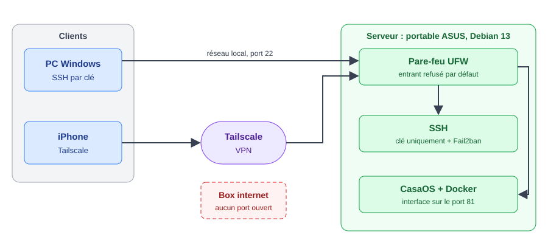

# Home lab : serveur Debian sécurisé

Petit serveur personnel monté sur un vieux PC portable, pour m'entraîner à l'administration système et à la cybersécurité (BTS SIO).

## Objectifs

- Réutiliser un ancien PC portable comme serveur allumé en continu
- Héberger des services en auto-hébergement avec CasaOS
- Appliquer les bonnes pratiques de sécurité : pare-feu, accès distant sans port ouvert, SSH durci, protection contre le brute force
- Documenter chaque étape pour garder une trace reproductible

## Matériel et logiciels

| Élément | Détail |
|---|---|
| Machine | Portable ASUS reconverti en serveur |
| Système | Debian 13 (trixie) avec KDE |
| Gestion des services | CasaOS (Docker), interface sur le port 81 |
| Accès distant | Tailscale (VPN), aucun port ouvert sur la box |
| Sécurité | UFW, SSH par clé, Fail2ban |

## Architecture



## Sécurisation

### 1. Pare-feu UFW

Politique par défaut : tout le trafic entrant est refusé, tout le trafic sortant est autorisé. Seuls sont autorisés l'interface Tailscale et SSH/CasaOS depuis le réseau local.

```bash
sudo apt install ufw
sudo ufw default deny incoming
sudo ufw default allow outgoing
sudo ufw allow in on tailscale0
sudo ufw allow from 192.168.1.0/24 to any port 22,81 proto tcp
sudo ufw enable
sudo ufw status verbose
```

### 2. Accès distant avec Tailscale

Tailscale est installé sur le serveur et sur mon téléphone. Je peux atteindre le serveur depuis l'extérieur sans ouvrir aucun port sur ma box.

### 3. SSH par clé uniquement

Génération d'une clé ed25519 protégée par une passphrase sur mon PC, puis copie de la clé publique sur le serveur.

```powershell
ssh-keygen -t ed25519
type .\ma_cle.pub | ssh utilisateur@IP_SERVEUR "mkdir -p ~/.ssh && chmod 700 ~/.ssh && cat >> ~/.ssh/authorized_keys && chmod 600 ~/.ssh/authorized_keys"
```

Une fois la connexion par clé testée, le mot de passe et le login root sont désactivés :

```bash
echo -e "PasswordAuthentication no\nPermitRootLogin no" | sudo tee /etc/ssh/sshd_config.d/00-hardening.conf
sudo sshd -t
sudo systemctl restart ssh
sudo sshd -T | grep -i passwordauthentication   # doit afficher "no"
```

Vérification : `ssh -o PubkeyAuthentication=no utilisateur@IP_SERVEUR` doit répondre `Permission denied (publickey)`.

### 4. Fail2ban

Bannissement d'une IP pendant 1 heure après 5 échecs de connexion SSH en 10 minutes. Le réseau local et Tailscale sont ignorés pour éviter de se bloquer soi-même.

```bash
sudo apt install fail2ban
sudo tee /etc/fail2ban/jail.local > /dev/null <<'EOF'
[DEFAULT]
ignoreip = 127.0.0.1/8 ::1 192.168.1.0/24 100.64.0.0/10

[sshd]
enabled = true
backend = systemd
maxretry = 5
findtime = 10m
bantime = 1h
EOF
sudo systemctl enable fail2ban
sudo systemctl restart fail2ban
sudo fail2ban-client status sshd
```
## Labo attaque et défense

Un deuxième volet du homelab : une application volontairement vulnérable (OWASP Juice Shop) installée sur le serveur, pour s'entraîner à trouver et comprendre des failles web réelles, dans un cadre légal et isolé.

### Mise en place

- Juice Shop tourne dans un conteneur Docker, lié uniquement à `127.0.0.1` sur le serveur (jamais exposé sur le réseau local).
- Accès depuis mon PC via un tunnel SSH :
  ```bash
  ssh -i cyberdevhomelab -L 3000:127.0.0.1:3000 homelab@IP_SERVEUR
  ```
  puis `http://localhost:3000` dans le navigateur.

### Défi 1 : trouver le compte administrateur

En inspectant les requêtes réseau (onglet Réseau des outils de développement, F12), certaines réponses de l'API exposaient plus de données que ce qui était affiché à l'écran. Ça a permis d'identifier l'adresse du compte admin : `admin@juice-sh.op`.

**Leçon retenue :** une API ne doit jamais renvoyer plus de données que nécessaire à l'affichage, même si l'interface n'en montre qu'une partie.

### Défi 2 : contourner la connexion (injection SQL)

En testant des caractères spéciaux dans le formulaire de connexion, le serveur a renvoyé une erreur SQL révélant la requête brute construite côté serveur :

```
SELECT * FROM Users WHERE email = '<email saisi>' AND password = '<hash du mdp>' AND deletedAt IS NULL
```

Le texte saisi dans le formulaire est inséré directement dans la requête, sans être filtré : c'est une injection SQL classique.

**Leçon retenue :** une entrée utilisateur ne doit jamais être concaténée directement dans une requête SQL. La protection consiste à utiliser des **requêtes préparées/paramétrées**, où la valeur saisie est toujours traitée comme une donnée et jamais comme du code SQL.

### Outils utilisés

- Docker (conteneur isolé, exposé uniquement en local)
- Tunnel SSH pour l'accès à distance
- Outils de développement du navigateur (onglet Réseau)
## Problèmes rencontrés et solutions

- **`ssh-copy-id` absent sous Windows** : remplacé par une commande PowerShell avec `type ... | ssh`.
- **Mot de passe SSH refusé** : le mot de passe de CasaOS n'est pas celui de l'utilisateur Linux. Réinitialisé avec `sudo passwd`.
- **Désactivation du mot de passe sans effet** : le fichier de configuration n'avait pas été créé (commande `tee` sans nom de fichier). Découvert avec `sudo sshd -T`, qui affiche la configuration réellement appliquée.
- **Docker et UFW** : Docker contourne en partie UFW pour les ports qu'il publie. À traiter dans une prochaine étape.

## Prochaines étapes

- [ ] Gérer l'interaction entre Docker et UFW
- [ ] Supervision avec Uptime Kuma
- [ ] Détection d'intrusion avec Wazuh
- [ ] Centralisation des journaux (Grafana et Loki)
- [ ] Sauvegardes automatiques
- [ ] Mesurer la consommation électrique du serveur

## Captures d'écran

À ajouter : `ufw status verbose`, `fail2ban-client status sshd`, interface CasaOS.
